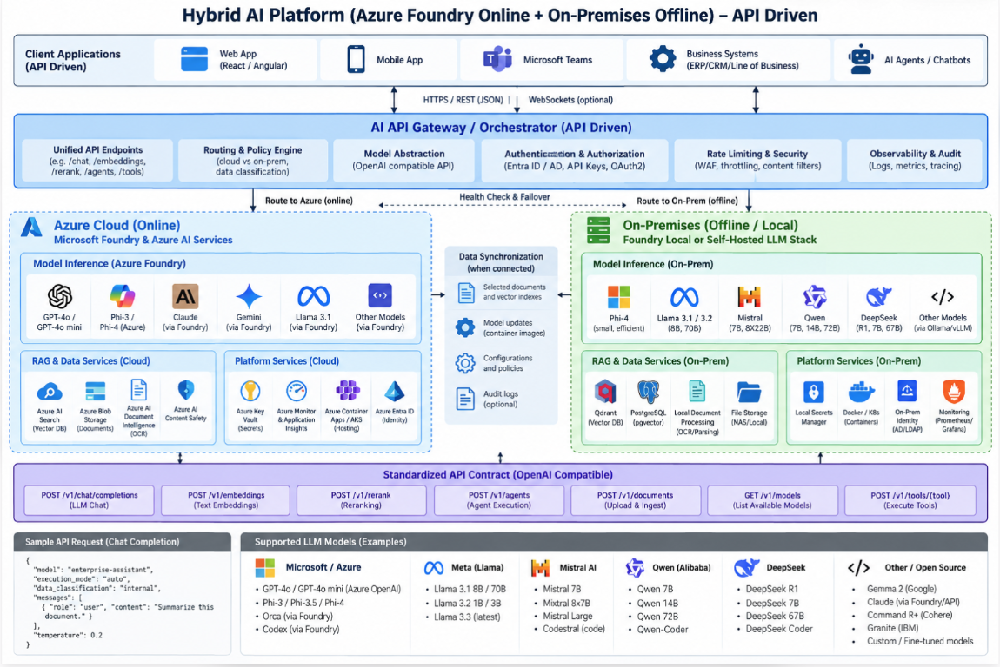

## Azure AI Foundry Cost Calculator

Build an AI budget that connects business demand to model consumption,
application infrastructure, local equipment, and operational effort.
The calculator supports cloud-only, local-only, and hybrid scenarios so that
business, finance, and engineering teams can discuss the same assumptions.

[Open the calculator](https://foundry-cost-planner-kvenk.azurewebsites.net/#solution)
| [Read How costing works](https://foundry-cost-planner-kvenk.azurewebsites.net/#how-costing-works)
| [Azure deployment guide](./README-AZURE.md)

The app's GitHub repository tab links to the source code and project
documentation. Azure hosting instructions remain in the deployment guide above.

> [!IMPORTANT]
> This is a planning tool, not an Azure quote, invoice, sizing guarantee, or
> live connection to your subscription. Published prices and exchange rates are
> bundled snapshots. Replace example quantities with measured workload data.

## Business context

An AI pilot can have inexpensive model calls and still become an expensive
production service. Retrieval, document processing, gateways, private
connectivity, monitoring, support, and local infrastructure can outweigh token
charges, especially when usage is low and provisioned services run continuously.

The calculator makes those cost layers visible before a funding or architecture
decision. It helps answer:

* What monthly and first-year budget should accompany the proposed use case?
* Which assumptions drive cost: adoption, prompt length, orchestration calls,
  service capacity, local equipment, or operations?
* How does a cloud-only proposal compare with a hybrid or local alternative?
* Which costs are recurring, which require upfront cash, and which represent
  allocation of equipment already owned?
* What evidence and assumptions should finance review before approving rollout?

The calculator does not determine whether an AI use case is valuable. A lower
forecast is useful only when the proposed design still meets quality, latency,
security, availability, and operating requirements.

### Who should use it

| Audience | Business decision | Review focus |
| --- | --- | --- |
| Business sponsor or product owner | Fund a pilot, expand adoption, or revise scope | Expected demand, service quality, benefits, and affordable cost per task |
| Finance or FinOps team | Establish a budget and compare alternatives | Price provenance, cash timing, reserves, allocation, and exclusions |
| Architect or engineering lead | Select models and supporting services | Token usage, call patterns, capacity assumptions, dependencies, and routing |
| Operations or infrastructure team | Support cloud and local delivery | Equipment, power, maintenance, licences, support effort, and continuity |
| Procurement or governance team | Validate commercial and control assumptions | Contract prices, region and model eligibility, access, and approval evidence |

### AI cost use-case library

[Explore all 10 use cases in the app](https://foundry-cost-planner-kvenk.azurewebsites.net/#ai-cost-use-cases).

These are planning guides, not automatic presets. Opening a use-case input link
does not replace the current scenario. The calculator reports operating cost per
planned task; outcome-based measures below require a separate calculation using
the same cost scope and time period.

#### 1. Customer support and service agents

Estimate a complete case, including multi-turn conversations, retrieval, tool
calls, retries, human review, and escalation. Use one task per case and measure
average calls across all attempts, including failures. Add paid APIs and human
handling as custom recurring costs when they are in scope.

Compare cost per successfully resolved case at a consistent service quality and
response time. Lower model spend is not a saving if poor answers increase repeat
contacts. Do not count retries twice when measured calls already include them.

#### 2. Employee knowledge and RAG assistants

Measure questions, retrieved-context tokens, embedding volume, document changes,
search capacity, storage, and ingestion operations. Separate initial indexing
from recurring refreshes, and price generation independently from retrieval.

Track cost per accepted, grounded answer and the required freshness and quality.
Reducing cloud-routed generation does not automatically reduce provisioned
search, ingestion, or storage quantities.

#### 3. Invoice, claims, and document processing

Use one task per document and measure pages, calls, extraction tokens, retention,
exceptions, and human corrections. For a machine queue, one workload user with
documents per day as tasks is a usable convention when clearly documented.

Price OCR and extraction using the exact meter. The included Document
Intelligence Read rate is not a universal layout or prebuilt-extraction price.
Compare cost per accepted document, correction effort, and turnaround time;
one document is not necessarily one billable page.

#### 4. Multi-step agents and business automation

Budget planning, tool execution, validation, retries, sandbox compute, approval,
and recovery for workflows such as onboarding or reconciliation. Measure the
full call chain, including incomplete and difficult runs.

Use calls per business task and custom tool, worker, or reviewer lines.
Different model tariffs need separate scenarios. Compare cost per correctly
completed workflow and completion rate. Runtime limits and approval policies
must be implemented in the application; this calculator does not enforce them.

#### 5. Coding assistants and code-review agents

For API-based assistance, measure tasks per engineer, repository-context tokens,
billed output including reasoning, review calls, and test-and-repair loops.
Add indexing, build runners, storage, and human review as separate costs.

Track cost per accepted, tested change or reviewed pull request, not generated
lines of code. Seat-based licences are custom service costs rather than an
automatic token-price equivalent. Select the applicable context tariff and
count billed reasoning once.

#### 6. Batch classification and summarization

Model catalogue enrichment, tagging, backlog processing, and summarization using
one task per item. Include failed or repeated jobs, queue storage, worker hours,
and the required completion window.

Global PAYG presets do not imply batch pricing, eligibility, quotas, or delivery
guarantees. Use verified custom batch or contract rates in a separate scenario.
Compare cost per accepted item and on-time completion, and do not apply a
discount again when it is already included in the chosen rate.

#### 7. Voice assistants and contact-centre analytics

Measure billed audio minutes or tokens, transcription, generated speech,
text-model processing, telephony, recordings, and retention. Reconcile each
quantity with the exact service's billing unit.

The model engine estimates text-token costs; it does not natively infer audio
pricing. Add speech and telephony costs as custom lines. Avoid double counting
when a tariff bundles modalities. Compare cost per analyzed audio hour or
successful interaction, alongside latency and transcription quality.

#### 8. Image analysis and video inspection

For product images, visual document review, or inspections, measure images,
frames, resolution/detail level, modality-specific tokens, storage, transfer,
video processing, and human verification.

Image and video prices are not inferred from file count or duration. Use
measured billable tokens only when they match the selected tariff, or add
explicit custom modality costs. A text-only preset is not proof of vision
support. Compare cost per validated image or inspected video hour and the
false-accept/reject rate.

#### 9. Branch, retail, and industrial edge assistants

Compare local or hybrid delivery for intermittent connectivity or data-location
constraints. Measure devices per site, utilization, peak concurrency, power,
maintenance, local storage, updates, and support visits.

Use local equipment and operating lines, with purchase timing and useful life.
Hardware fields represent a homogeneous device group; different device classes
need separate scenarios and shared-cost reconciliation. Compare cost per site
and successful local task together with offline availability. Zero Azure
model-token cost does not mean zero operating cost or validated capacity.

#### 10. Model evaluation and release assurance

Budget test cases, model candidates, repeated runs, judge calls, test compute,
trace retention, and expert review. Separate initial model selection from
recurring regression and release checks.

Use separate scenarios for distinct candidate or judge tariffs. Add reviewer,
compute, and monitoring costs as custom lines, with the actual one-time or
recurring cadence. Track cost per accepted release or qualified candidate
against quality thresholds. The calculator does not run evaluations, measure
accuracy, or automate governance approval.

### Compare use cases without double counting

1. Define the business task and successful outcome. Include failures and rework
   in the cost base.
2. Create low, expected, and high demand scenarios from measured volumes,
   token sizes, call chains, capacity, and human effort.
3. Separate rollout and initial ingestion from recurring operations. Assign
   custom lines to the correct cloud, local, or shared environment. Preserve
   fixed services that remain provisioned even at low adoption.
4. Calculate outcome unit cost separately as in-scope cost divided by successful
   outcomes in the same period. Use cash budgets for funding or allocated costs
   for economic comparisons.
5. Save scenario JSON and export CSV evidence. When combining workloads,
   allocate shared hosting, search, grants, and operations once.

One scenario uses one model tariff and one average workload. The application
does not automatically load use-case presets, consolidate model portfolios,
calculate ROI, model demand growth, or enforce spending limits. Do not add
several complete solution budgets without reconciling their shared costs.

## What the calculator includes

| Cost layer | Examples | Planning treatment |
| --- | --- | --- |
| Model consumption | Ordinary input, cache reads, separately priced cache writes, output | Token volume multiplied by the applicable rate |
| Azure infrastructure | Hosting, AI Search, API Management, storage, document processing, monitoring, networking | Quantity in each meter's billing unit, including supported progressive tiers |
| Local equipment | Device count, asset value, useful life | New purchases as upfront cash; asset allocation as monthly amortization |
| Local operations | Electricity, maintenance, support, licences, backup, facilities | Hardware-derived costs plus entered service lines |
| Shared and one-time services | Implementation, rollout, security, consulting | Assigned to cloud, local, or shared scope; recurring or one-time |
| Budget reserve | User-selected contingency percentage | Added to recurring operating cash, not an Azure charge |

Selected components are examples, not a complete or validated reference
architecture. Add required services and remove items your design does not use.

## Hybrid AI platform reference diagram



[View the full-size diagram](./dist/assets/hybrid-ai-platform.png)
| [Explore the Architecture tab](https://foundry-cost-planner-kvenk.azurewebsites.net/#architecture)

The supplied diagram connects client applications to an API gateway and
orchestration layer, with routes to Azure online services and an on-premises
inference and retrieval environment. It also illustrates supporting identity,
security, monitoring, and controlled synchronization when connected.

Use the diagram to identify cost lines, not to assume every named component
is included in the estimate. Cloud model tokens, retrieval, hosting, gateways,
networking, local equipment, and operations have separate cost drivers.

> [!WARNING]
> This is a conceptual, user-supplied reference, not an Azure-certified blueprint
> or a compatibility guarantee. Verify current model availability, API support,
> licences, downloadable weights, and regional eligibility. A shared API
> contract does not make a cloud dependency available offline. Disconnected
> operation requires locally available application, identity, model, and data
> services; Teams and other cloud-hosted clients still require connectivity.

## Costing methodology

### 1. Translate business activity into calls

```text
Monthly tasks = active users x tasks per user per day x active days
Monthly model calls = monthly tasks x average model calls per task
Cloud calls = monthly model calls x cloud share
Local calls = monthly model calls - cloud calls
```

One business task may involve classification, retrieval, generation, tool use,
retries, and evaluation. Measure the average model calls per task rather than
assuming that one user interaction produces one API call.

For planning, the selected cloud share applies proportionally to model calls,
input tokens, and output tokens. Cloud-only mode forces 100%; local-only mode
forces 0%. If cloud and local requests have different token profiles, create
separate scenarios instead of assuming the proportional split is precise.

### 2. Calculate model token costs

```text
Input tokens = monthly model calls x average input tokens per call
Output tokens = monthly model calls x average output tokens per call
Ordinary input = total input - cache-read input - cache-write input
Category cost = category tokens / 1,000,000 x category rate
Cloud model cost = full-workload model cost x cloud share
```

Input should include system instructions, conversation history, retrieved
context, and other billed request content. Output should include billed
reasoning tokens where applicable, without counting them twice.

Cache reads and separately priced writes are mutually exclusive categories
within input. Their shares together cannot exceed 100%. A preset without a
verified separate cache rate does not assume a discount for that category.
Request-length tariffs must be chosen deliberately; calculate mixed tariff
populations separately.

The Model costs tab prices the full workload. Its comparison table does not
include the whole solution's infrastructure or local equipment. The solution
engine applies routing to the model subtotal and adds the active cost layers.
It does not carry over the Model costs tab's other charges or allowance, which
would risk double counting.

### 3. Price infrastructure in its actual billing units

```text
Billable quantity = max(0, entered quantity - allocated free quantity)
Flat service cost = billable quantity / billing-unit size x rate
```

Provisioned capacity uses provisioned hours, even if few users interact with
the application. A monthly quantity of 730 hours is a planning convention;
actual calendar months vary. Replicas, partitions, instances, storage,
transactions, and network traffic have different units.

Supported progressive meters calculate each band separately. Allocate shared
free grants only once and only to the extent they remain available. Do not
subtract an allowance again when it is already embedded in the tier schedule.

Moving model calls local does not automatically reduce search, ingestion,
gateway, storage, or other service quantities. Resize each affected component
explicitly. An App Service plan shared by multiple apps should be allocated
consistently rather than charged in full to every app.

### 4. Add local equipment and operating costs

```text
Hardware asset value = devices x asset value per device
Monthly amortization = hardware asset value / useful life in months
Monthly power = devices x watts / 1,000 x powered hours x PUE x price per kWh
Monthly maintenance = hardware asset value x annual maintenance percentage / 12
```

Existing hardware can have no new purchase cash while still carrying an
allocation, electricity, maintenance, and support cost. Amortization here is a
planning allocation, not a recommendation for accounting or tax treatment.
Add local model licences and operating labour when applicable.

Local inference has no Azure token charge in this model. That does not make
it free or demonstrate that the equipment can serve the workload. Validate
throughput, concurrency, memory, latency, and availability with representative
tests before approving the design.

### 5. Separate cash requirements from allocated cost

| Output | Calculation | Business interpretation |
| --- | --- | --- |
| Monthly operating cash | Cloud + local + shared recurring costs | Forecast recurring cash before reserve |
| Fully allocated monthly cost | Operating cash + hardware amortization | Recurring cost including equipment allocation, before reserve |
| Monthly planning budget | Operating cash x (1 + reserve percentage / 100) | Operating budget with a chosen contingency |
| Upfront cash | New hardware purchases + enabled one-time services | Initial cash required by the scenario |
| Year 1 cash budget | Upfront cash + 12 x monthly planning budget | First-year cash forecast |
| Horizon cash budget | Upfront cash + horizon months x monthly planning budget | Constant-run-rate forecast across the selected period |
| Operating cost per task | Monthly operating cash / monthly tasks | Planned task unit cost, excluding reserve and amortization |

Hardware purchase cash is included once. Amortization is not added to the cash
budgets again. The horizon assumes the same monthly run rate and no automatic
hardware replacement, demand growth, financing, discounting, or inflation.

## Worked business example

Consider an internal knowledge assistant for 100 employees, each completing
10 tasks on 22 active days per month. Assume one call per task, 2,000 input
tokens, 500 output tokens, and an 80% cloud share.

The following custom prices and quantities are illustrative assumptions, not
a quote for any named model or an estimate of the app's own hosting bill.
Caching is set to zero.

| Assumption | Illustrative value |
| --- | --- |
| Custom input / output rates | USD 0.25 / USD 2.00 per million tokens |
| Cloud infrastructure | USD 150 per month |
| Local support and software | USD 50 per month |
| Local equipment | 2 devices at USD 1,500 each, purchased now |
| Useful life | 36 months |
| Electricity assumptions | 100 watts per device, 730 hours, PUE 1.2, USD 0.15/kWh |
| Annual maintenance | 12% of equipment asset value |
| Implementation | USD 1,000 one-time |
| Planning reserve | 20% of monthly operating cash |

| Calculation | Result |
| --- | --- |
| Monthly tasks and calls | 22,000 |
| Cloud / local calls | 17,600 / 4,400 |
| Full-workload input / output | 44 million / 11 million tokens |
| Full-workload model cost | USD 33.00 |
| Routed cloud model cost | USD 26.40 |
| Local power / maintenance | USD 26.28 / USD 30.00 per month |
| Monthly operating cash | USD 282.68 |
| Monthly hardware amortization | USD 83.33 |
| Fully allocated monthly cost, before reserve | USD 366.01 |
| Monthly planning budget, including reserve | USD 339.22 |
| Upfront cash | USD 4,000.00 |
| Year 1 cash budget | USD 8,070.59 |
| 36-month cash budget | USD 16,211.78 |
| Operating cost per planned task | Approximately USD 0.012849 |

The model charge is only USD 26.40 of USD 282.68 in monthly operating cash.
In this example, optimizing the model price alone would miss most of the
operating cost. Conversely, shifting traffic local does not automatically
justify purchasing equipment: capacity, resilience, and operating effort still
need validation.

Totals are calculated at full precision and rounded for display. Multiplying
the displayed monthly budget by 12 can differ slightly from the displayed
first-year result.

## Connect the forecast to business value

Use the calculator's cost outputs as one input to a separate business case:

```text
Potential hours saved = monthly tasks x minutes saved per task / 60
Realized capacity value = potential hours saved x loaded hourly cost
                          x realization percentage
Net monthly benefit = realized benefit - comparable monthly solution cost
```

Time saved is not automatically payroll savings. A realization percentage
should reflect adoption, answer quality, human review, rework, and whether
released capacity is redeployed or actually reduces spending.

For service operations, also consider turnaround time, backlog, error rates,
customer experience, and revenue impact. Measure those outcomes in a pilot.
The application does not calculate ROI, payback, or benefit realization.

Use matching cost bases: cash budgets for funding decisions, or allocated
costs for economic comparisons. Cost per planned task is not cost per successful
outcome. Adjust the denominator separately when failures or human rework matter.

## Recommended planning and governance workflow

1. Define the business task, success criteria, scope, accountable owner, and
   quality or latency requirements.
2. Measure representative calls, input and output tokens, retry behavior,
   document volume, and retrieval activity from a pilot.
3. Build low, expected, and high demand scenarios. Change assumptions explicitly;
   the application does not generate a sensitivity analysis automatically.
4. Select cloud, local, or hybrid routing, then size each supporting component
   independently. Keep quality and service levels comparable between options.
5. Review source meters, units, remaining free grants, contract prices,
   currency assumptions, and missing cost lines with finance and engineering.
6. Export the full solution CSV for review and save scenario JSON for reuse.
   Include the owner, decision date, and assumptions in the approval record.
7. After rollout, reconcile the same time period and resource scope against
   Azure Cost Management, invoices, local expenses, and operational metrics.
   Revisit the forecast when demand, architecture, contracts, or prices change.

The live audit trail shows current quantities, rates, sources, and tier bands.
An enabled component with billable usage but no price keeps final totals
unavailable. A zero price is an explicit assumption, not a missing rate.
Completeness confirms only that selected components are priced.

## Pricing, currency, privacy, and limitations

* Bundled Azure price evidence is dated 22 October 2026 and uses USD reference
  meters for East US 2. Model presets cover the selected Global PAYG tariffs.
  Verify the exact meter, deployment, region, model version, quota, and
  eligibility before making a commitment. The calculator's Central US hosting
  location does not change its reference pricing region.
* Retail prices are not negotiated contract prices. Taxes, discounts, support
  agreements, unlisted services, and other commercial adjustments require
  explicit treatment.
* Solution prices normalize to USD before conversion into the reporting
  currency. The bundled ECB reference rates or your overrides are planning
  rates, not a promise of Azure invoice or settlement exchange rates.
* Changing the Model costs tab's custom-rate currency changes the meaning of
  the entered rates without converting those numbers. Whole-solution reporting
  conversion is a separate feature.
* Calculations and scenario inputs are processed in the browser. The app does
  not connect to your Azure account or automatically refresh pricing. Normal
  hosting request logs can still exist. The current deployment is public;
  avoid confidential data in labels, shared exports, or support screenshots.
* Saved JSON and CSV files contain your assumptions and custom prices. Treat
  them according to your organization's information-handling requirements.
* A local-only costing scenario is not a certified offline deployment of this
  hosted website or proof that a proposed architecture can operate disconnected.

## Local-only AI deployment

Selecting Local only changes the estimate; it does not provision infrastructure,
install a model, connect this calculator to inference, stop Azure resources, or
make the public website available disconnected. Cloud-domain lines and Azure
model-token charges are excluded, while enabled local and shared lines remain.

[Open the local deployment guide in the app](https://foundry-cost-planner-kvenk.azurewebsites.net/#local-only-deployment).

### Choose the deployment boundary

| Decision | Windows / on-device | Linux / shared server |
| --- | --- | --- |
| Intended use | AI embedded in each user's desktop application | A local service for multiple concurrent users |
| Inference option | Foundry Local SDK, with optional local REST server | Dedicated serving runtime such as vLLM on supported hardware |
| Capacity validation | Memory, latency, and quality per device class | Accelerator memory, concurrency, throughput, and recovery capacity |
| Application dependencies | Device-local UI, model, and required data | Local gateway, identity, persistent data, and operations |

Neither path is implemented by this repository. The calculator describes and
costs the planned system; an actual AI application, orchestration layer, and
retrieval integration must be built and deployed separately.

### Windows and on-device deployment with Foundry Local

1. Review the current [Microsoft quickstart](https://learn.microsoft.com/en-us/azure/foundry-local/get-started)
   and [SDK reference](https://learn.microsoft.com/en-us/azure/foundry-local/reference/reference-sdk-current).
   Confirm Windows, driver, hardware, language-runtime, and model requirements.
2. Integrate the Windows-specific Foundry Local SDK into your application.
   Follow the official sample for runtime initialization, execution-provider
   discovery and registration, model acquisition, inference, and model unloading.
3. Prepare while connected. Download required execution providers and model
   assets, approve their licences, pin versions, and retain files required by
   your deployment process. Do not defer downloads to a disconnected session.
4. Use the SDK directly for embedded inference. If other device-local processes
   need REST, configure the optional local server and use its actual endpoint.
   Do not assume a fixed port or an older CLI workflow matches every release.
5. Stage the application, documents, embedding model, compatible vector index,
   OCR, configuration, identity, and secrets as needed. An online identity
   refresh or remote document service breaks the offline path.
6. Test a cold start and complete business task with internet blocked. Check
   memory, response time, answer quality, local permissions, restart behavior,
   missing model handling, and recovery on every supported device class.

Foundry Local is optimized for on-device inference, usually one user per device;
it is not a general-purpose multi-user server stack. No Azure subscription is
required for local inference. Device purchase, licences, rollout, electricity,
maintenance, and support still belong in the business case.

### Linux and shared-server deployment

1. Select an inference runtime and a supported Linux, accelerator, and driver
   combination. Validate model architecture, quantization, context length,
   memory, concurrency, and latency with representative workloads.
2. Prepare a pinned runtime environment or container image while connected.
   Stage the full approved model, tokenizer, configuration, chat template, and
   dependencies. Check download and redistribution licences; retain an offline
   package or image source and an approved rollback version.
3. With a compatible [vLLM installation](https://docs.vllm.ai/en/stable/serving/online_serving/),
   serve an already staged local model directory. The following is a Linux shell
   example, not an installer or a complete production deployment:

   ```bash
   export HF_HUB_OFFLINE=1
   export TRANSFORMERS_OFFLINE=1
   vllm serve /srv/models/approved-instruct \
     --host 127.0.0.1 \
     --port 8001 \
     --served-model-name local-assistant
   ```

   Replace the path with your approved model directory. Check the current
   [serving command reference](https://docs.vllm.ai/en/stable/cli/serve/) and
   model-specific chat-template and API support. These environment flags limit
   model-hub access; they do not prove all application dependencies are local.
4. Configure a separately deployed application or gateway to use
   `http://127.0.0.1:8001/v1` when it runs on the same host. A container's loopback
   is its own network namespace, not the host's. For separate hosts or containers,
   configure a private route, firewall rules, TLS, and authentication explicitly.
5. Add local document storage, an embedding model, a compatible vector store
   such as Qdrant or pgvector where needed, and local secrets and identity.
   Ensure document permissions survive ingestion and retrieval.
6. Operate services with a process supervisor or approved container platform.
   Configure startup order, health checks, persistent volumes, resource limits,
   logs, backups, update approval, and rollback. Do not expose an unauthenticated
   inference endpoint to the internet.

### Offline acceptance checklist

* Block internet access, cold-start the system, authenticate locally, and finish
  a representative task including retrieval and document processing.
* Verify inference, embeddings, identity, secrets, fonts, UI assets, model hubs,
  licence checks, registries, and OCR have no required cloud dependency.
* Test unavailable local capacity, denied access, missing models, a service
  restart, and backup restoration. Queue or reject restricted requests rather
  than silently routing them to cloud inference.
* Record model and runtime versions or image digests, hardware specifications,
  throughput, latency, quality results, operating owner, and rollback procedure.
* Populate local costs with purchase timing, useful life, measured power,
  powered hours, PUE, electricity, maintenance, licences, storage, monitoring,
  backup, operations labour, and one-time implementation.
* Review actual Azure resources separately. A calculator scenario does not
  decommission them or prevent ongoing Azure charges.

## Run the calculator locally and deploy

Use Node.js 24 LTS. The host has no npm dependencies and needs no build step.

```powershell
node .\server.cjs
```

Open <http://localhost:8080>. Set `PORT` if another application uses that port.
The server serves only the ready-to-run `dist` directory.

The host binds to `0.0.0.0`, so use an OS firewall to restrict access for a
single-device deployment. For a shared LAN installation, configure a local HTTPS
reverse proxy and required authentication. Transfer the repository and Node
runtime before disconnecting; the calculator then serves its bundled assets
without npm downloads. This does not install or connect an AI backend.

See [README-AZURE.md](./README-AZURE.md) for Azure packaging, runtime
configuration, access considerations, and deployment commands.

| Source | Responsibility |
| --- | --- |
| [server.cjs](./server.cjs) | Dependency-free static host |
| [dist/index.html](./dist/index.html) | Application UI and in-app business guide |
| [dist/calculator.js](./dist/calculator.js) | Workload and model-token calculations |
| [dist/hybrid-engine.js](./dist/hybrid-engine.js) | Routing, infrastructure, hardware, and budget calculations |
| [dist/solution.js](./dist/solution.js) | Scenario orchestration, currencies, audit trail, and exports |

## Further reading

* [Azure Retail Prices API](https://learn.microsoft.com/en-us/rest/api/cost-management/retail-prices/azure-retail-prices)
* [Plan and manage Azure AI Foundry costs](https://learn.microsoft.com/en-us/azure/foundry/concepts/manage-costs)
* [Azure App Service hosting plans](https://learn.microsoft.com/en-us/azure/app-service/overview-hosting-plans)
